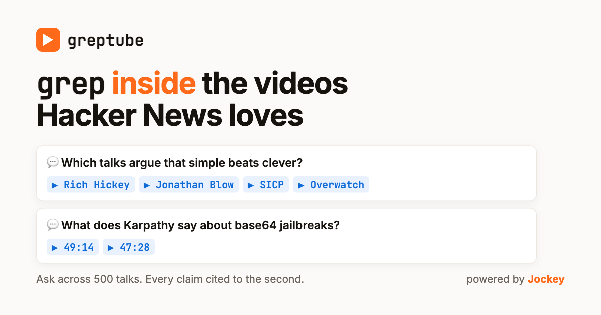

# greptube

**Ask questions inside the videos Hacker News keeps recommending.** Live at [greptube.com](https://greptube.com).



An unofficial remix of [@karpathy](https://x.com/karpathy)'s [HackerTube](https://hackertube.org), built on
his open dataset. HackerTube helps you find the videos; greptube lets you ask questions inside them.
The video understanding is [Jockey](https://www.twelvelabs.io/jockey) from TwelveLabs: it watches each
video end to end (speech, slides, what's on screen) and answers with every claim cited to the second.

On the site you can:

- **Ask** across all the videos: "Which talks argue that simple beats clever?"
- **Get a watch plan**: "The best 45 minutes on how LLMs work", as exact segments
- **Make a cut**: "Cut Karpathy's 1-hour LLM talk down to 2 minutes", played back as one video
- **Find a moment** by what's said or shown

## The whole trick is one API call

Everything above is one call to Jockey's Responses API with a different instruction:

```bash
curl https://api.twelvelabs.io/v1.3/responses \
  -H "x-api-key: $TL_API_KEY" -H "content-type: application/json" \
  -d '{
    "model": "jockey1.0",
    "knowledge_store_id": "'"$KS_ID"'",
    "input": [{"type": "message", "role": "user",
               "content": "Which talks argue that simple beats clever?"}]
  }'
```

The answer's text comes with `video_citation` annotations (`item_id`, `start_sec`, `end_sec`) for each
claim. The page turns each one into a link that plays that exact moment. A "cut" is the same call with an
instruction to answer as a list of 15–40 s clips, which the page plays back to back.

The three instructions (ask, watch plan, cut) are in [`lib/core.mjs`](lib/core.mjs). The same API also works
inside Claude through the Jockey MCP connector.

## Run it on your own videos

1. Get a TwelveLabs API key: [twelvelabs.io/jockey](https://www.twelvelabs.io/jockey).
2. Create a knowledge store and add your videos. The quickest way is Claude with the Jockey connector:
   *"Create a knowledge store called my-talks and add these YouTube links."* Note its `ks_...` id.
3. Put your list in `public/data/videos.json` (`[{"vid": "<youtube id>", "title": "...", ...}]`), then map
   YouTube ids to store items: `TL_API_KEY=... KS_ID=... python3 scripts/sync_items.py`.
4. Run it: `TL_API_KEY=... KS_ID=... node dev-server.mjs`, then open http://localhost:8787.

To deploy, import the repo into Vercel and set `TL_API_KEY` and `KS_ID`. The key stays on the server;
the browser only ever talks to `/api/*`.

## What's where

| Path | What it does |
| --- | --- |
| `public/index.html` | The whole site: one static page, no build step |
| `api/ask.mjs`, `lib/core.mjs` | Streams Jockey's answer back, keeping only text and citations; per-IP rate limits |
| `api/search.mjs` | "Find a moment": clip search over the store |
| `scripts/` | Bake the example answers, watch plans, cuts and key moments into `public/data/` so first clicks are instant |

## Credits

Video list, summaries, topics and HN quotes come from [HackerTube's open dataset](https://hackertube.org/data)
by Andrej Karpathy; the comments belong to their Hacker News authors. Not affiliated with HackerTube.
Videos play from YouTube.

Code is MIT. The data under `data/` and `public/data/` keeps its sources' terms.
